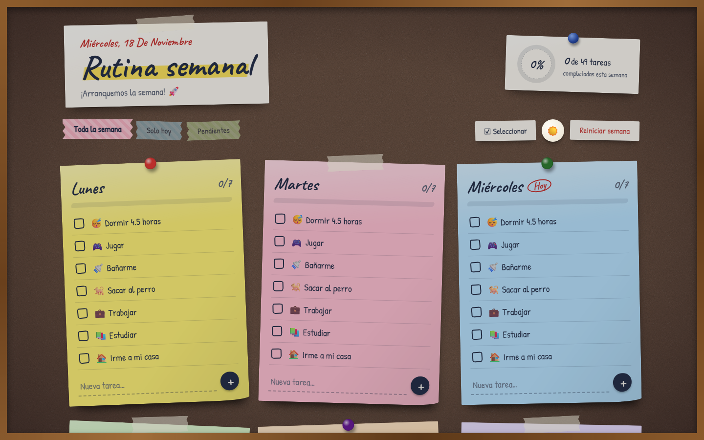

# 📝 Rutina Semanal

**Organizador de tareas semanal con estilo de notas adhesivas sobre un tablero de corcho**

## ✨ Características

- 🗓️ Una nota por cada día de la semana, con el **día actual resaltado**
- ✅ Marca tareas con un chulito dibujado a mano y animado
- 📊 **Anillo de progreso** semanal y contador por día
- 🔎 Filtros: toda la semana, solo hoy o pendientes
- ☑️ **Selección múltiple** para borrar varias tareas a la vez
- ➕ Agrega tus propias tareas a cada día
- 🎉 Confeti al completar
- 🌗 Tema claro/oscuro
- 💾 Guarda todo en `localStorage`, así no pierdes tu progreso
- ♿ Respeta `prefers-reduced-motion`

## 🚀 Correr en local

Solo abre `index.html` en el navegador.

---

Hecho por <a href="https://github.com/alejo234506">ALEJO-SQ</a> 🇨🇴

